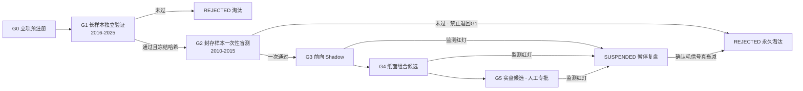

# 信号质量评价体系（SQF · Signal Quality Framework）设计方案

**状态**：**仅设计，未实现任何代码、未创建台账文件、未运行任何新回测**（停在等磊确认门槛、市场状态定义与报警阈值后再实现）。  
**定位**：新信号从立项、独立验证、封存样本一次性盲测到前向 shadow 持续监测的唯一标准化评价底座。与官方数据管道（`official_pipeline/`）及 R8 前向 shadow（`archive/R8/PREREG_SHADOW_300K.md`）并行推进，不改变后两者的既有优先级与启动条件。

---

## 0. 硬边界与纪律（先行写死）

1. **本次与后续实现的四条红线**：
   - **不开发新信号**：SQF 本身只提供评价、归因、台账与闸门基础设施，不夹带任何新因子、新过滤或参数改动。
   - **不在 2016–2025 年上做新的探索**：除第 9 节规定的 R8 A 信号已知案例只读复现验收测试外，不对 2016–2025 长样本运行任何新组合、消融或筛选。
   - **不改正式层**：`universe.json`、`execution_rules.json`、`configs/formal_rule_lock.json`、`historical_backtest_latest.json`、`paper_book_latest.json`、`.github/workflows/historical_backtest.yml`（继续暂停）及席位逻辑一律不触碰。
   - **2010–2015 年只查覆盖、不看价格**：沿用 `docs/COVERAGE_2010_2015_PROBE.md` 的封存规则——已确认可取的 SHFE / DCE 2010–2015 数据作为封存保留样本，在信号完成设计、提交预注册并通过 G1 之前不得下载价格、不得打开；后续若补查 CZCE 2010–2015 历史路径或全量交易日存在性，仍只允许记录 HTTP 状态码、字节数与记录条数，严禁解析或保存价格。

---

## 1. 信号接口规范（与组合层彻底解耦）

### 1.1 注册单元（`SignalSpec`）

每个信号是独立的注册单元，落盘于只读注册表（设计路径：`research/sqf/registry/`），身份由 `(signal_id, version, code_sha256)` 唯一锁定：

| 字段 | 类型 | 说明 |
|---|---|---|
| `signal_id` | `str` | 稳定信号标识，如 `path_a_core`、`carry_ts_v1` |
| `family` | `str` | 信号族标识（用于同族试验计数），如 `momentum_breakout`、`term_structure` |
| `version` | `str` | 语义版本号（如 `1.0.0`）；任何逻辑、参数或出场条件改动必须升版 |
| `code_sha256` | `str` | 信号生成函数 AST 规范化源码 + 固定参数 JSON 序列化的 SHA-256；运行前强制校验与注册值一致 |
| `universe_codes` | `list[str]` | 适用交易品种列表（默认 27 品种或显式声明的子集） |
| `warmup_bars` | `int` | 信号在时点 `t` 评估所需的最少历史根数（只允许读 `≤ t` 的数据） |
| `prereg_doc` | `str` | 对应的预注册文档路径与提交 git commit |
| `stage` | `str` | 当前生命周期阶段：`G0` / `G1` / `G2` / `G3` / `G4` / `G5` / `SUSPENDED` / `REJECTED` |

### 1.2 标准信号事件契约（`SignalEvent`）

信号模块**只负责回答单品种时点 `t` 的交易意图与单笔风控边界**，完全不知道账户本金、已有持仓、剩余槽位、板块占用或名义敞口帽。其唯一合法输出为标准事件流：

```json
{
  "event_id": "path_a_core@1.0.0|2020-03-09|RB|-1",
  "signal_id": "path_a_core",
  "version": "1.0.0",
  "code_sha256": "<64-hex>",
  "signal_date": "2020-03-09",
  "code": "RB",
  "direction": -1,
  "entry_spec": {
    "rule": "next_open",
    "ref_close": 3421.0
  },
  "stop_spec": {
    "rule": "fixed_atr_from_fill",
    "stop_distance_price": 54.4,
    "initial_stop_ref": 3475.4
  },
  "exit_spec": {
    "target_distance_price": 108.8,
    "trail_rule": null,
    "signal_invalidation": "r20_flip_or_r60_flip",
    "max_hold_days": null
  }
}
```

**解耦硬约束**：
1. **六个核心要素齐全**：`signal_date`（日期）、`code`（品种）、`direction`（方向：`+1` 多 / `-1` 空）、`entry_spec`（入场规则与参考价）、`stop_spec`（初始止损距离，决定 `1R` 分母）、`exit_spec`（止盈/移动止损/信号失效出场条件）。
2. **严禁混入组合状态**：信号函数入参只含截至 `t` 日收盘的单品种（或预先声明的截面）行情与基础元数据，**禁止传入当前持仓簿 `pos`、账户权益 `equity`、`slots_left` 或板块计数**。
3. **1R 分母唯一定义**：每手初始止损风险 `risk_per_lot = stop_distance_price × mult`（与引擎 `abs(entry_ref - stop_ref) * mult` 一致，`stop_distance_price > 0` 为硬前置校验）。

---

## 2. 四层归因体系与引擎钩子复用

对同一组注册信号事件，在统一窗口与统一数据源上自下而上计算四层表现，每层全部以 **R 倍数** 为主单位（同时保留每手元与按口径 (b) 手数加权元）：

### 2.1 四层定义

| 层级 | 名称 | 成交范围与仓位规则 | 成本规则 | 每笔 R 定义 |
|---|---|---|---|---|
| **① 毛信号层** | Gross Signal | **全部信号独立成交**：不受持仓槽位、板块上限、名义帽或是否已持仓限制；同品种相邻日信号各自独立建仓、独立管理出场。仓位采用**口径 (b)**：固定 2% 风险、参考本金 `E_ref = 1,000,000` 元，`lots_b = floor(0.02 × E_ref / risk_per_lot)`；`lots_b == 0` 的事件单独记为「不可成交」并剔除出均值（同时保留固定 1 手的**口径 (a)** 备查） | **不扣任何成本**（`slippage_ticks = 0`，`fee_mult = 0`，换月平移只移价差、不收双边手续费与滑点） | \( R_i^{(1)} = \dfrac{\text{gross\_pnl}_i}{\text{lots}_i \times \text{risk\_per\_lot}_i} \) |
| **② 扣成本层** | Costed Signal（Base / Stress） | 事件集合、入场日、出场日、换月次数与第 ① 层**逐笔完全相同**（成本不改变行情触及止损/止盈/信号反转的时点） | 按 `research_cost.json` 分别扣除 **Base** 与 **Stress** 两套成本（含入场、每次 `shifted` 换月旧平+新开 2 笔、出场） | \( R_i^{(2,s)} = \dfrac{\text{gross\_pnl}_i - \text{cost}_i^{(s)}}{\text{lots}_i \times \text{risk\_per\_lot}_i} \)，\( s \in \{\text{base}, \text{stress}\} \) |
| **③ 组合层** | Portfolio-Constrained | 叠加组合分配规则（`max_positions`、`max_per_bucket`、已持同品种跳过、`max_gross_exposure_pct`、`max_portfolio_risk_pct`、缩手补手及可选品种池）后，在组合回测里**实际入选成交的子集** \( S_{\text{traded}} \subset S_{\text{all}} \) | 同第 ② 层的 Base / Stress 成本 | 主指标：\( S_{\text{traded}} \) 上的等权平均每笔 \( R^{(3,s)} \)（附组合实际手数加权总净盈亏、最大回撤、年化与落选分组表） |
| **④ 实际执行层** | Forward Execution（Shadow / Paper） | 前向运行期间（G3 shadow 或 G4 纸面账户）按实时盘后确认数据实际触发并记录的交易集合 \( S_{\text{exec}} \) | 同时记录**假设成本（Base/Stress）**与**实际执行成本**（若有盘口 bid/ask 或真实成交价则按实际滑点计，纯日线 shadow 阶段记录与同窗重放差） | \( R_j^{(4)} = \dfrac{\text{realized\_or\_mtm\_net\_pnl}_j}{\text{lots}_j \times \text{risk\_per\_lot}_j} \) |

> **期末未平仓事件处理**：与 R8 附录 A.3 一致——回测窗口末仍持仓的事件按窗口末日收盘价盯市并计入对应层（在输出里单独披露 `n_open_at_end`）；窗口最后一天发出、次日无 bar 未能成交的事件记为 `unfilled`，不计入各层 R 均值。

### 2.2 层间差额（瀑布拆解公式）

对任意成本情景 \( s \in \{\text{base}, \text{stress}\} \)（主判定固定采用 **Stress、口径 (b)**）：

1. **摩擦损耗（① → ②）**：
   \[
   \Delta_{1 \to 2}^{(s)} = \overline{R}^{(2,s)} - \overline{R}^{(1)} = -\overline{c}_R^{(s)} \le 0
   \]
   衡量纯手续费、滑点及持仓换月双边摩擦对单笔期望 R 的吞噬；\(\overline{R}^{(2,\text{base})} - \overline{R}^{(2,\text{stress})}\) 为**成本敏感度**。
2. **组合筛选与容量效应（② → ③）**：
   \[
   \Delta_{2 \to 3}^{(s)} = \overline{R}^{(3,s)} - \overline{R}^{(2,s)}
   \]
   - \(\Delta_{2 \to 3} > 0\)：组合帽与排序规则整体筛掉了劣质信号（例如 R8 A 在 Stress 下为 \(-0.039 - (-0.065) = +0.026\text{R}\)）；
   - \(\Delta_{2 \to 3} < 0\)：组合槽位或名义帽把高期望信号挡在门外。
   - 配套输出 R8 附录 A.3 的互斥完备去向表：① 实际成交、②a 有空槽排名落选、②b 满仓未评估、③ 板块已满、④ 已持同品种 / 名义帽缩至 0 / 0 手不可成交，以及同（信号日, 板块）格子的「取最强」选中减落选差值。
3. **执行偏离损耗（③ → ④，仅前向阶段存在）**：
   \[
   \Delta_{3 \to 4} = \overline{R}^{(4)} - \overline{R}^{(3,\text{replay})} = \underbrace{\left(\overline{R}^{(4,\text{assumed\_cost})} - \overline{R}^{(3,\text{replay})}\right)}_{\text{时点快照/主力识别/漏单偏离}} + \underbrace{\left(\overline{R}^{(4)} - \overline{R}^{(4,\text{assumed\_cost})}\right)}_{\text{实际滑点与手续费超支}}
   \]
   其中 \(\overline{R}^{(3,\text{replay})}\) 是在完全相同的前向日期区间上用定型官方/标准数据全量重放第 ③ 层得到的结果。

### 2.3 复用现有 R8 引擎钩子（零侵入设计）

SQF 第 ①–③ 层直接复用已在 `main` 合入并通过对账验证的钩子，不改写 `PositionEngine` 与正式回测主路径：

1. **`trade_start` 钩子**（`historical_backtest.py` 第 1475 行）：`_ls["trade_start"]` 将窗口起点之前的行情严格作为指标与 ATR 预热期，交易只在 `[w0, w1]` 内发生。
2. **`signal_layer` 独立事件轨钩子**（`historical_backtest.py` 第 1524、1608、1748、2184 行）：传入 `long_sample={"trade_start": w0, "signal_layer": {}}`，配合 `max_positions = 10**6`、`equity0 = 1e12`（排除手数取整为 0 对候选生成的干扰），由同一个 `PositionEngine.fill_selected` 与 `PositionEngine.manage` 逐日独立撮合全部信号事件，输出 `signal_layer.events` 与 `signal_layer.open_at_end`。
3. **三套成本一次后处理**（复用 `archive/R8/long_sample.py::trade_net_pnl`）：因为止损/止盈触及判据与成本无关，只需跑 **1 次** `signal_layer` 模拟即可拿到全部独立成交轨迹：
   - 调 `trade_net_pnl(t, meta, slip=0.0, fee_mult=0.0)` → `gross` 即得 **第 ① 层（毛信号）**；
   - 调 `trade_net_pnl(t, meta, slip=slip_base, fee_mult=fm_base)` → `net` 即得 **第 ② 层（Base）**；
   - 调 `trade_net_pnl(t, meta, slip=slip_stress, fee_mult=fm_stress)` → `net` 即得 **第 ② 层（Stress）**；
   - 再与常规组合运行的 `closed_pnls` / `final_positions` 做 `(code, entry_date)` 对账（复用 `archive/R8/attrib_signal.py::classify`），即得 **第 ③ 层**，并自动验证已成交子集每手净盈亏与组合层逐笔差 `≈ 0`。
4. **非 Path-A 新信号的接入方式**：新信号只需实现第 1.2 节的 `SignalEvent` 生成器，通过轻量适配器喂给同一个 `PositionEngine`（复用 `fill_selected` / `manage` / `trade_net_pnl`），即可获得与 Path-A 完全同尺度的四层归因。

---

## 3. 结构变化与信号衰减的拆分

当比较两个时期（例如基准期 `0` = 回测期或前半段，观察期 `1` = 新近段或前向 shadow 期）时，第 ① 层毛信号平均 R 的变化 \(\Delta \mu = \mu_1 - \mu_0\) 可能来自两种性质截然不同的原因：**市场落入不利状态的时间变多了（结构/环境漂移）**，或**同一市场状态下信号本身不灵了（真衰减）**。

设市场状态划分为互斥完备的 \( K \) 个格子 \( k \in \{1, \dots, K\} \)（定义见第 5 节，只用 `≤ t` 信息）：
- 期 \( p \in \{0, 1\} \) 内落入状态 \( k \) 的可成交事件数为 \( n_{p,k} \)，总事件数 \( N_p = \sum_k n_{p,k} \)，状态占比 \( w_{p,k} = n_{p,k} / N_p \)；
- 状态 \( k \) 在期 \( p \) 内的第 ① 层毛信号平均 R 为 \( \mu_{p,k} = \frac{1}{n_{p,k}} \sum_{i \in (p,k)} R_i^{(1)} \)，期总体均值 \( \mu_p = \sum_{k=1}^K w_{p,k} \mu_{p,k} \)。

### 3.1 主分解公式（对称 Shapley / Marshall–Edgeworth 形式，无残差项）

记中点权重 \( \bar{w}_k = \frac{1}{2}(w_{0,k} + w_{1,k}) \)，中点状态均值 \( \bar{\mu}_k = \frac{1}{2}(\mu_{0,k} + \mu_{1,k}) \)，对共同非空状态集 \( K_{\text{common}} = \{k : n_{0,k} > 0 \land n_{1,k} > 0\} \)（空状态处理见下）：

\[
\mu_1 - \mu_0 = \underbrace{\sum_{k} \bar{w}_k (\mu_{1,k} - \mu_{0,k})}_{\text{状态内 R 的变化（真衰减 / 增强）}} + \underbrace{\sum_{k} (w_{1,k} - w_{0,k}) \bar{\mu}_k}_{\text{状态比例的变化（环境结构变化）}}
\]

### 3.2 辅助三项展开（基准期权重 Kitagawa–Oaxaca 形式，供交叉核对）

同时在 JSON 产物中保留以基准期 `0` 为锚的三项式：

\[
\mu_1 - \mu_0 = \underbrace{\sum_k w_{0,k}(\mu_{1,k} - \mu_{0,k})}_{\text{纯状态内变化}} + \underbrace{\sum_k (w_{1,k} - w_{0,k})\mu_{0,k}}_{\text{纯比例变化}} + \underbrace{\sum_k (w_{1,k} - w_{0,k})(\mu_{1,k} - \mu_{0,k})}_{\text{交互项}}
\]

### 3.3 边界与小样本格子规则

1. **空状态格子（\( n_{0,k}=0 \) 或 \( n_{1,k}=0 \)）**：若某状态格子在观察期未出现（\( n_{1,k}=0 \)），不能计算 \(\mu_{1,k}\)；此时先在共同出现的非空状态子集上重归一化权重做精确两项分解，并将「仅单期出现的状态占比与拉动值」单列为 `unmatched_regime_effect`，确保账面恒等闭合。
2. **置信区间**：对「状态内 R 变化」和「状态比例变化」两项同时使用第 4.1 节的**按月分块 bootstrap**（每次重抽月份后重算 \( w_{p,k}^* \) 与 \( \mu_{p,k}^* \)），给出各自的 95% 置信区间，防止把几个月的随机波动误判为真衰减。
3. **计算对象**：强制在第 ① 层（毛信号 R）计算主分解（彻底剥离手续费调整与组合帽干扰），并附第 ② 层（Stress R）同构分解备查。

---

## 4. 统计置信度与全局试验台账

### 4.1 按月分块 Bootstrap（主均值与差额区间）

直接复用 `archive/R8/attrib_signal.py::boot_mean` 的写死规范：
- **分块单位**：信号日所属自然月 `YYYY-MM`（同时吸收同品种相邻日独立建仓的序列自相关，以及同日跨品种截面相关）。
- **重抽样过程**：设有效月份数为 \( M \)，每月的事件 R 之和与事件数记为 \( (S_m, N_m) \)。用固定随机种子 `SEED = 20261126`、抽样次数 `B = 10,000`，每次有放回抽取 \( M \) 个月份索引，计算加权总体均值 \( \bar{R}^{*(b)} = \frac{\sum_{j=1}^M S_{m_j}}{\sum_{j=1}^M N_{m_j}} \)。
- **区间输出**：取 `2.5%` 与 `97.5%` 分位数作为双侧 95% 置信区间 `[lo, hi]`。

### 4.2 PSR 与 DSR（非重叠周期口径防虚高）

复用仓库现有 `lab/validation/psr.py::probabilistic_sharpe_ratio` 与 `lab/validation/dsr.py::deflated_sharpe_ratio`（Bailey & López de Prado 公式），但**对输入序列做强制防虚高约束**：

1. **禁止把重叠独立事件直接当独立观测**：第 ①/② 层同品种相邻日信号会各自持仓重叠，若直接把 `n = 15,476` 代入 \(\sqrt{n - 1}\)，有效自由度会被夸大数倍至十余倍，导致虚假高 PSR/DSR。
2. **信号层标准输入序列（主口径）**：将信号事件按**自然月**聚合为月度平均 R（或月度等权信号组合净值收益率序列，样本长度 \( T = \text{月数} \)，`periods_per_year = 12.0`），在此**非重叠月度序列**上计算年化 Sharpe、偏度 \(\gamma_3\)、超额峰度 \(\gamma_4 - 3\)、PSR（相对 `SR* = 0`）与 DSR（相对 `E[max SR | N_trials]`）。
3. **组合层对照口径**：第 ③ 层同时输出与 R8 `_evaluate_oos.py` 一致的组合日频净值 / 交易序列 PSR、DSR，便于与历史归档报告直接横向核对。

### 4.3 全局试验台账 `research/trial_ledger.jsonl`（Schema 与补登规范）

> **注意**：本节只定义文件格式、计数规则与历史补登范围；实现获批前**不创建**该文件。

#### （1）单行 JSONL Schema（只追加、不可删改）

```json
{
  "schema": "cta-trial-ledger-v1",
  "trial_id": "TR-20261125-R8-OOS-001",
  "recorded_at": "2026-11-26T00:00:00+08:00",
  "era": "R1_R8_backfill",
  "completeness": "complete",
  "completeness_note": "",
  "signal_id": "path_a_core",
  "signal_version": "0.14.0-r8",
  "family": "path_a_momentum",
  "code_sha256": "efc49b9...",
  "trial_kind": "candidate_oos",
  "data_scope": "official_2016_2025",
  "window": ["2016-01-04", "2025-12-31"],
  "params_summary": {"group": "A1000k", "guard_pct": 0.05, "mode": "base"},
  "prereg_doc": "archive/R8/PREREG_OOS.md",
  "artifact_path": "archive/R8/OOS/A1000k/result_stress.json",
  "counts_toward_dsr": true,
  "trial_weight": 1,
  "reason_if_excluded": null
}
```

#### （2）哪些记录计入 DSR 的 `N_trials`（机械规则，禁止事后裁量）

- **必须计入（`counts_toward_dsr = true`）**：任何涉及信号逻辑、入场条件、过滤条件（如 F1/F2）、出场参数（如 RR 网格、止损倍数）、品种池规则（如 C）、因子权重组合（如消融网格、混合网格）的运行——无论结果好坏、是否写入报告、是否中途放弃，每跑一组配置记 `1` 次试验。
- **登记但不计入信号择优试验数（`counts_toward_dsr = false`，须填 `reason_if_excluded`）**：
  1. 纯回测/账本工程 bug 修复且不改策略规则的基线重放（如 R0–R6 假止损、夜盘归属、跳空按开盘成交、换月复权工程修复）；
  2. 只读数据质量探测（如 `LONG_COVERAGE_REPORT`、`LONG_FEASIBILITY_REPORT`、`2010–2015` 覆盖探测）；
  3. 预注册已明确声明不产生候选的纯事后诊断/对账（如 R8 的 300k 诊断档、附录 A 桥接与亏损归因、SQF 对 R8 A 的验收复现测试）。

#### （3）R1–R8 及早期历史记录盘点与补登映射

实现阶段将编写一次性可复现补登脚本，把仓库现有证据链全部补登进 `research/trial_ledger.jsonl`：

| 历史批次 | 仓库现存证据来源 | 试验条数 | 完整性标记 | 说明 |
|---|---|---|---|---|
| **前 R0 策略与参数网格** | `archive/rr_grid.json`、`archive/shadow_strategy_opt_t1_20261111.json`（8 组）、PBO 试验矩阵（11 组）、`archive/shadow_{ema_cross,pullback_abc,pullback_abc_60m_1r,rr2_next_open,tight_high_rr_t1,lift_t1}_20261111.json` | 已落盘约 18–25 组（去重后逐条登记） | **`incomplete`** | 早期交互式调参与未落盘尝试无法证明穷尽，显式标注 `completeness="incomplete"`，并记录「账面下界」 |
| **桌面代理与消融扫描** | `data/ablation/strategy_indicator_ablation_latest.json`、`strategy_blend_latest.json`、`data/experiments/ledger.jsonl`（LSP、Gamma、Vol、Arb V1.1–V1.3） | 按各文件实际 `rows` 逐条展开补登 | **`incomplete`** | `ablation` 默认模式曾多次覆盖 `latest.json`，历史运行总次数不完整，标 `incomplete` |
| **R0–R7 阶段 A（可信度修复）** | `archive/R0/`–`archive/R7/`、`docs/UPGRADE_ITERATIONS.md` | R0–R6 工程修复（`counts_toward_dsr=false`）；R7 正式重跑沿用前序参数集 | **`complete`** | 每刀有 git commit、冻结快照与逐笔对比文件 |
| **R8a / R8b（216 天窗口）** | `archive/R8/PREREG.md`、`results_table.json`（base + E100k/300k/500k/1000k + F1/F2/F1F2，连同前序披露合计 `n_trials=18` / 披露口径 `21`） | 7 个新增组 + 基线对照（对齐 R8 台账 18 / 21） | **`complete`** | 有独立预注册与完整 JSON |
| **R8 长样本 OOS 与收尾** | `archive/R8/PREREG_OOS.md`、`OOS/`（9 组：`A/B/C × 800k/1000k/1200k`，累计 `n_trials=30`）、`DIAG300K_REPORT.md`、`ATTRIB/` | 9 组计入 DSR；300k 诊断与附录 A 记诊断类 | **`complete`** | 预注册在运行前提交，重放一致性已验 |

#### （4）DSR 试验数读取规则

- 严禁在评估代码里硬编码 `n_trials = 11` 或 `n_trials = 30`。
- SQF 评估器强制调用 `read_dsr_trial_count(ledger_path, scope=...)` 从 `research/trial_ledger.jsonl` 动态统计 `counts_toward_dsr == true` 的记录总数：
  - 同时计算两个口径：**全局口径 `N_global`**（全仓累计所有计入 DSR 的试验数）与 **信号族口径 `N_family`**（同 `family` 累计试验数，且对已打开过同一长样本的数据集设保底基数）。主闸门采用 `N_global` 还是 `N_family` **【待确认】**（推荐主判定用 `N_global`，报告卡并列展示两者）。
  - 只要被统计集合中存在任一条 `completeness == "incomplete"` 的历史记录，报告卡置信度栏必须自动打印固定警示：`[历史台账含不完整早期记录，N_trials 为已登记下界，DSR 为乐观上界]`。

---

## 5. 市场状态（Market Regime）定义与防过拟合铁律

### 5.1 硬约束

1. **维度与档位上限**：最多 **3 个维度**，每个维度 **2–3 档**（总状态空间上限 `≤ 27` 格；推荐 `2×2×2 = 8` 格或 `3×2×2 = 12` 格，避免格子过碎导致单格样本不足）。
2. **严格因果（无未来信息）**：信号日 `t` 的市场状态标签 `regime(t)` **只能使用 `≤ t` 收盘已知的数据**。任何分位数阈值只能用**滚动历史窗口**或**截至 `t` 的扩张窗口（含最少预热期）**，严禁使用全样本（如 2016–2025 全期）均值或分位数回填历史状态。
3. **数据源一致性**：状态指标必须在 2016–2025 官方日线、2010–2015 封存日线与前向日线上具有完全相同的计算定义（因此候选主维度全部基于 27 品种日频复权收益与同合约 ATR 构建，不依赖仅有数月历史的分钟线、期权 IV 或外部升贴水缓存）。

### 5.2 候选状态维度定义（【待确认】，确认后写死）

以下列出 3 个正交维度的候选定义（附 1 个备选维度供替换），等磊确认维度选择、档数（2 档或 3 档）与切分阈值后写入配置锁死：

| 维度槽位 | 候选指标（均在 `t` 日收盘用 `≤ t` 的 R6c 同合约无跳空序列计算） | 候选档位切分方案 A（2 档，推荐保样本量） | 候选档位切分方案 B（3 档） | 表征含义 |
|---|---|---|---|---|
| **维度 1：市场波动水平（Vol）** | 27 个在市品种当日 `ATR14(t) / ATR100(t)` 比值的截面中位数 `V(t)`（无量纲、自带品种自归一化，无需跨十年分位预热） | `Low/Normal`：`V(t) ≤ 1.05`<br>`High`：`V(t) > 1.05` | `Low`：`V(t) < 0.85`<br>`Mid`：`0.85 ≤ V(t) ≤ 1.15`<br>`High`：`V(t) > 1.15` | 截面整体波动处于压缩、常态还是扩张/冲击期 |
| **维度 2：截面趋势扩散度（Trend Breadth）** | 27 个在市品种标准化 60 日动量强度 `\|r60_i(t)\| / (ATR14_i(t)/Close_i(t) × √60)` 的截面中位数 `B(t)`（或超过动量门槛品种占比） | `Choppy`（震荡）：`B(t) ≤ 中位阈值（如 1.0）`<br>`Trending`（趋势）：`B(t) > 1.0` | 按过去滚动 500 个交易日 `B` 的 `33% / 67%` 历史分位切分为 `Weak / Mid / Strong` | 全市场处于无方向拉锯还是多板块趋势展开 |
| **维度 3：截面同涨同跌相关度（ Co-movement）** | 在市品种过去 20 个交易日 roll-free 日收益率的两两 Pearson 相关系数均值 `C(t)` | `Dispersed`（分化）：`C(t) ≤ 0.25`<br>`Coupled`（宏观共振）：`C(t) > 0.25` | `Low`：`C(t) < 0.15`<br>`Mid`：`0.15 ≤ C(t) ≤ 0.30`<br>`High`：`C(t) > 0.30` | 品种独立走基本面行情，还是受宏观/流动性驱动高度同向波动（如 2020 疫情或单边通胀冲击） |
| *备选替换维度：期限结构广度* | *由官方逐合约日线直接算近月与次主力年化展期率为贴水（backwardation）的品种占比* | *`Contango_Dom` `< 50%` vs `Back_Dom` `≥ 50%`* | *`< 35% / 35–65% / > 65%`* | *仅在需要商品库存周期视角时替换维度 3；必须用官方逐合约自算，不用 2025-10 才有的外部升贴水缓存* |

### 5.3 只做描述、禁止直接变过滤的治理铁律

1. **描述专用**：市场状态表在报告卡中的唯一合法用途是：（a）展示信号在哪些市场环境下赚钱/亏钱；（b）执行第 3 节的「状态内真衰减 vs 状态比例变化」分解。
2. **禁止事后抠格子当过滤器**：即使报告卡显示某信号在 `High Vol + Choppy` 格子里平均 R 为 `-0.25R`，**绝对禁止直接在现有信号或组合配置上加一条「该状态下不开仓」并宣称提升了表现**（R8b 的 F2 已经证明：样本内看似有效的状态过滤，在前后半段和长样本 OOS 上均未通过）。
3. **若确有经济理由引入状态条件**：必须作为**全新信号版本**立项，分配新 `version` 与新 `code_sha256`，在 `research/trial_ledger.jsonl` 新增计入 DSR 的试验条目，并重新受 G0–G5 门禁约束。

---

## 6. 前向衰减与成本偏差监测（G3–G5 运行期）

当信号进入前向阶段（G3 shadow 及以后）时，以该信号冻结回测期（G1 + G2 合并或 G1 锁定基准）的第 ② 层 Stress 分布参数 \( (\mu_0, \sigma_0) \)、第 ① 层毛均值 \( \mu_0^{(1)} \) 及假设单笔成本 \( \overline{c}_{R,0}^{(\text{base})}, \overline{c}_{R,0}^{(\text{stress})} \) 作为固定先验基准（前向期间**不随新数据重估 \(\mu_0, \sigma_0\)**，防止基准随衰减一起下移而失灵）。

### 6.1 三项核心监测指标

1. **滚动窗口均值监测（Rolling Mean R）**：
   - 对最近 \( W \) 笔已平仓前向事件计算滚动平均 \( \overline{R}_W^{(2,\text{stress})} \) 与 \( \overline{R}_W^{(1)} \)，并与基准预期差 \( \overline{R}_W - \mu_0 \) 及基准同口径标准误 \( \sigma_0 / \sqrt{W} \) 对比。
2. **单侧下向表格型 CUSUM（One-Sided Lower Tabular CUSUM）**：
   - 用于尽早捕捉均值从基准 \(\mu_0\) 向劣化水平 \(\mu_1 = \mu_0 - \delta \sigma_0\)（或绝对零值 `0`）的持续下移。
   - 令第 \( i \) 笔已平仓前向事件的标准化残差为 \( z_i = \dfrac{R_i^{(2,\text{stress})} - \mu_0}{\sigma_0} \)（同时对第 ① 层毛信号平行维护一条 \( C_i^{(1)} \) 以区分 alpha 衰减与成本恶化）：
     \[
     C_0 = 0, \qquad C_i = \max\!\left(0,\; C_{i-1} - z_i - k\right)
     \]
   - 其中参考松弛量 \( k = \delta / 2 > 0 \)（允许正常随机波动归零，只有平均下移超过 \( k \sigma_0 \) 时才持续累积）；当 \( C_i > h \) 时触发**单侧衰减报警**。
3. **实际成本相对假设成本的偏差监测（Cost Drift Monitor）**：
   - 对每一笔前向执行交易 \( j \)，记录实际单笔成本占 1R 比例 \( c_{R,j}^{(\text{actual})} \) 与同笔交易按 Base / Stress 公式算出的假设成本 \( c_{R,j}^{(\text{base})}, c_{R,j}^{(\text{stress})} \)：
     - **相对 Base 成本偏差**：\( \Delta c_{R,j} = c_{R,j}^{(\text{actual})} - c_{R,j}^{(\text{base})} \)，以及成本倍率 \( \rho_j = c_j^{(\text{actual})} / \max(c_j^{(\text{base})}, \epsilon) \)；
     - **相对 Stress 上界突破率**：最近 \( W \) 笔中 \( c_{R,j}^{(\text{actual})} > c_{R,j}^{(\text{stress})} \) 的占比。
   - *说明*：在纯日线 T+1 开盘价前向 shadow 阶段（无实盘成交回报），若有当日盘口快照（如期权/期货活链 bid-ask），用盘口半价差估算隐含滑点对照 `1 tick` / `2 ticks` 假设；若无盘口数据，该项显式标 `N/A (daily-bar shadow only)`，不伪造为 `0` 偏差。

### 6.2 报警阈值候选值（【待确认】，确认后写死）

| 监测项 | 候选保守档（灵敏，早预警） | 候选标准档（推荐讨论起点） | 候选宽松档（低误报） | 触发后动作（见第 7 节） |
|---|---|---|---|---|
| **最少起测笔数 `N_min`** | `15` 笔 | **`20` 笔** | `30` 笔 | 未满 `N_min` 只展示数值、灯号标 `WARMING_UP` |
| **滚动窗口 `W` 与报警线** | `W = 20` 笔，\(\overline{R}_W < \mu_0 - 1.65 \frac{\sigma_0}{\sqrt{W}}\) 或 \(\overline{R}_W < -0.05\text{R}\) | **`W = 30` 笔，\(\overline{R}_W < \mu_0 - 2.0 \frac{\sigma_0}{\sqrt{W}}\) 且 \(\overline{R}_W < 0\)** | `W = 50` 笔，\(\overline{R}_W < \mu_0 - 2.5 \frac{\sigma_0}{\sqrt{W}}\) | 黄灯预警 / 达硬线转红灯降级 |
| **单侧 CUSUM 参数 `(k, h)`** | `k = 0.25, h = 4.0`（针对 `0.5σ` 下移） | **`k = 0.50, h = 5.0`**（标准 Page 参数，针对 `1.0σ` 下移，正态零漂移下 ARL₀ ≈ 465 笔） | `k = 0.50, h = 6.0` | `C_i > 0.7h` 黄灯；`C_i > h` 红灯触发暂停复盘 |
| **成本偏差报警线** | 滚动 `20` 笔平均 \(\rho > 1.3\) 或超 Stress 占比 `> 15%` | **滚动 `30` 笔平均实际成本 > Base + 0.5×(Stress − Base)，或超 Stress 占比 `> 20%`** | 滚动 `30` 笔平均实际成本 `> Stress` | 触发「执行成本异常」红灯（先查执行/换品种，不等同于毛信号淘汰） |

---

## 7. 晋级门槛 G0–G5 与降级规则

### 7.1 单向生命周期与封存样本一次性铁律



#### **封存样本（2010–2015）核心铁律**

1. **只能打开一次**：2010–2015 封存保留样本对任一信号（含同机制微调变体）**全生命周期只允许运行一次**。运行前必须校验信号处于 `G1_PASSED` 状态、`code_sha256` 已锁定无未提交修改、且 `trial_ledger.jsonl` 中该信号从未访问过 `sealed_2010_2015`；开始运行的同一事务先写入一条不可撤回的访问记录，再读取数据。
2. **不通过直接淘汰，严禁回炉 G1**：若 G2 盲测未达到预先写死的门槛，该信号状态立即永久置为 **`REJECTED`**。**绝对禁止根据 2010–2015 的报错、亏损年份或亏损板块修改参数/加过滤后退回 G1 重测，也禁止再次打开 2010–2015。**
3. **品种覆盖前置约束**：鉴于 `docs/COVERAGE_2010_2015_PROBE.md` 已查明郑商所（CZCE）2010–2015 路径尚未确认，且部分品种晚于 2015 年上市（如 EG/EB/SA/SP/SS），进入 G2 前必须在预注册文档里事先写死可取交易所与上市品种子集规则，只按规则机械执行，不事后挑品种。

### 7.2 G0–G5 准入条件草案（所有数值阈值均标为【待确认】）

| 阶段 | 准入前置动作 | 评价内容 | 通过门槛草案（**【全部待确认】**） | 未通过处置 |
|---|---|---|---|---|
| **G0 · 立项与预注册** | 提交信号机制说明、`SignalSpec`、参数固定值、适用假设与失效场景 | 形式审查：接口纯洁性（无组合状态入参）、无未来函数静态检查、登记 `trial_ledger` | 文档与接口契约齐全，预注册先于运行提交 | 退回补齐规范 |
| **G1 · 长样本验证（2016–2025）** | G0 完成；仅对获批立项的新信号执行（**当前阶段不开启任何新信号**） | 跑 SQF 第 ①–③ 层（2016–2025 官方 + 5% 守卫）、月分块 bootstrap、非重叠月度 PSR/DSR、市场状态表 | ① 第 ② 层（Stress，口径 b）全部信号 \(\overline{R} > \text{【待确认：如 } 0.03\text{R】}\) 且 95% CI 下限 \(> \text{【待确认：如 } 0\text{R】}\)；<br>② 非重叠月度 DSR（取自 `trial_ledger`）\(\ge \text{【待确认：如 } 0.80 \text{ 或 } 0.90\text{】}\)；<br>③ 10 个自然年正 R 年份占比 \(\ge \text{【待确认：如 } 6/10\text{】}\)；<br>④ 组合层第 ③ 层（Stress）最大回撤 \(\le \text{【待确认：如 } 15\%\text{–}20\%\text{】}\) | 置 `REJECTED`（记录进 `trial_ledger`；未触碰 2010–2015） |
| **G2 · 封存样本盲测（2010–2015）** | G1 通过；`code_sha256` 与全套参数冻结签名；从未访问过封存库 | **一次性**在 2010–2015 封存官方数据上跑完全相同的第 ①–③ 层代码 | ① 第 ② 层（Stress，口径 b）\(\overline{R} > \text{【待确认：如 } 0\text{R】}\)；<br>② 第 ① 层相对 G1 的「状态内 R 变化」（第 3 节）未发生显著坍塌（下限 \(\ge \text{【待确认：如 } -0.05\text{R】}\)）；<br>③ 第 ③ 层（Stress）净收益 \(> 0\) 且最大回撤 \(\le \text{【待确认：如 } 20\%\text{】}\) | **永久 `REJECTED`；严禁退回 G1，严禁重跑 G2** |
| **G3 · 前向 Shadow** | G2 通过；官方数据管道连续正常 5 个交易日门已开；增量=全量重放单测通过 | 前向逐日只追加记录，积累第 ④ 层与第 6 节监测指标 | ① 运行时长 \(\ge \text{【待确认：如 } 6 \text{ 个月】}\) **且** 已平仓笔数 \(\ge \text{【待确认：如 } 30 \text{ 笔】}\)（对齐 `PREREG_SHADOW_300K.md` §5）；<br>② 前向第 ④ 层（Stress 成本）\(\overline{R} > \text{【待确认：如 } 0\text{R】}\)；<br>③ 期间未触发单侧 CUSUM 红灯与账户回撤硬停线（如 `> 15%`【待确认】） | 触发硬停则转 `SUSPENDED` 复盘；期满未达标则不晋级或 `REJECTED` |
| **G4 · 纸面组合候选** | G3 通过 + **磊人工签字** | 接入隔离的虚拟组合/纸面候选账本，跟踪组合边际相关性与执行成本偏差 | 持续时长 \(\ge \text{【待确认：如 } 3\text{–}6 \text{ 个月】}\)，\(\Delta_{3 \to 4}\) 执行偏离在容忍带内，无监测红灯 | 降回 `SUSPENDED` 或 `G3` |
| **G5 · 实盘候选审定** | G4 达标 + **磊专项书面授权**（系统永无自动晋级 `auto_promote = false`） | 真实盘口成本、保证金压力与极端情景人工终审 | 人工专批 + 持续受第 6 节实时衰减与成本熔断约束 | 触发任一红灯立即降回 `SUSPENDED` |

### 7.3 降级与熔断规则（G3 / G4 / G5 通用，阈值【待确认】）

前向运行中每日盘后机械核对以下条件，无需人工判断即触发状态切换：

1. **毛信号真衰减熔断（`SUSPENDED → REJECTED` 路径）**：
   - 第 ① 层毛信号单侧 CUSUM \( C_i^{(1)} > h \)【待确认】，且按第 3 节分解显示下跌主因是「状态内 R 变化 \(< 0\)」而非短期不利市场状态占比偏高 → 机械置为 `SUSPENDED`，复盘确认无数据源错误后打入 `REJECTED`。
2. **账户回撤硬停（对齐 shadow 纪律）**：
   - 组合逐日盯市权益相对峰值回撤 `> 15%`【待确认】→ 次一交易日起停止新开仓，转入 `SUSPENDED`。
3. **纯执行/成本恶化降级（可修复路径）**：
   - 第 ① 层毛信号正常（未触发 CUSUM），但第 6.1 节「实际成本相对假设成本偏差」触发红灯，或 \(\Delta_{3 \to 4}\) 超限 → 降级至 `SUSPENDED`（冻结纸面/实盘候选资格，排查滑点、流动性或换月执行细节，修复验证后经磊签字可恢复至 `G3` 观察，无需重开封存样本）。

---

## 8. 标准输出：单页信号质量报告卡（Signal Quality Report Card）

每个信号每次评估产出一对同源产物：`reports/sqf/{signal_id}_{version}_{asof}.json`（机器可读完整数据）与 `reports/sqf/{signal_id}_{version}_{asof}.md`（严格控制在一页以内的标准报告卡）。

### 8.1 一页报告卡固定版式模板

```markdown
# 信号质量报告卡 · <signal_id>@<version>

- **当前阶段**：`G1 / G2 / G3 / SUSPENDED / REJECTED` ｜ **生成日**：`YYYY-MM-DD` ｜ **自动晋级**：`DISABLED`
- **身份锁**：`code_sha256=<前12位>` ｜ **数据锁**：`pack_sha256=<前12位>` ｜ **预注册**：`<路径>@<commit>`
- **试验台账**：`N_global=<整数>` / `N_family=<整数>` ｜ **台账完整性**：`COMPLETE` 或 `INCOMPLETE（早期记录不完整，DSR为乐观上界）`

## 1. 四层归因瀑布（主口径：固定 2% 风险 口径 b，单位 R）
| 层级 | 事件/笔数 | 平均 R | 95% 月分块区间 | 胜率 | 层间差额 ΔR | 说明 |
|---|---:|---:|---:|---:|---:|---|
| ① 毛信号（0 成本） | 15,476 | +0.xxx | [+0.xxx, +0.xxx] | xx.x% | — | 独立成交，剔除 0 手 13 笔（未成交 7，期末盯市 23） |
| ②a 扣成本 · Base | 15,476 | -0.024 | [-0.088, +0.040] | 35.1% | Δ₁→₂ = -0.xxx | Base 交易+换月摩擦 |
| ②b 扣成本 · Stress（主判定） | 15,476 | -0.065 | [-0.132, +0.001] | 35.0% | Δ₁→₂ = -0.xxx | 成本敏感度(Base−Stress)=0.041R |
| ③ 组合层 · 实际成交(Stress) | 1,678 | -0.039 | [-0.116, +0.038] | 35.9% | Δ₂→₃ = +0.026 | 槽位满落选 -0.077R / 板块满 -0.152R / 取最强差 +0.044R |
| ④ 实际执行（前向 Shadow） | — | N/A | N/A | N/A | Δ₃→₄ = N/A | 尚未进入 G3 / 或展示前向实测 |

## 2. 统计置信度（非重叠月度聚合序列，T = <月数>）
- **月度年化 Sharpe（Stress ②b）**：`x.xx` ｜ **偏度 / 超额峰度**：`x.xx / x.xx`
- **PSR(SR* = 0)**：`0.xxx` ｜ **DSR(N_global = <N>)**：`0.xxx` ｜ **DSR(N_family = <M>)**：`0.xxx`
- **自然年正收益折数**：`x / 10`

## 3. 市场状态表（仅描述，严禁直接转过滤）与结构变化分解
| 状态格（Vol × Trend × Corr） | 样本数(占比) | ① 毛信号平均 R | ②b Stress 平均 R | 95% 区间 |
|---|---:|---:|---:|---|
| <状态 1..K 汇总行> | ... | ... | ... | ... |
- **跨期分解（期 0 `<起止>` → 期 1 `<起止>`，第 ① 层 ΔR = `<总变化>`）**：
  - 状态内 R 变化（真衰减/增强）：`<数值> R` `[lo, hi]`
  - 状态比例变化（环境结构漂移）：`<数值> R` `[lo, hi]`

## 4. 前向衰减与成本偏差监测（G3+ 启用）
- **状态灯**：`GREEN / YELLOW / RED / WARMING_UP / NOT_IN_FORWARD`
- **滚动均值（W=<30> 笔）**：`<数值> R`（基准 `μ0=<数值>`，报警线 `<数值>`）
- **单侧 CUSUM**：毛信号 `C^(1) = x.xx / h=<5.0>` ｜ Stress `C^(2) = x.xx / h=<5.0>`
- **成本偏差**：实际 vs Base 差 `<数值> R/笔` ｜ 超 Stress 占比 `xx.x%`

## 5. 阶段闸门核对（当前目标闸门：<G?>）
- [x / ] 条件 1 ...  ｜  **综合裁定**：`PASS / FAIL / HOLD（阈值待确认）`
```

---

## 9. 验收测试规范（已知案例：R8 的 A 信号）

在 SQF 代码实现阶段，**不开发任何新信号、不跑任何新参数**，唯一允许且必须通过的端到端验收测试是用 R8 已定稿的 **A 信号** 复现 `archive/R8/R8_CLOSEOUT.md` 附录 A.5.3 与权威落盘文件 `archive/R8/ATTRIB/signal_layer.json` 的数字。

### 9.1 固定测试输入

- **信号定义**：`signal_core.py::path_a_candidate`（基础模式：无席位、无升贴水，`vol_bypass` 同 R8 冻结配置，R6c 同合约无跳空信号与 ATR14）。
- **数据与窗口**：`2016-01-04 → 2025-12-31`，官方逐合约日线 + `5%` 成交量守卫（FU 起点 `2018-10-16`），输入包哈希必须严格等于 `pack_sha256 = 850b9021c082d129e3f6b24ed9abddf2ff55c9bc14d915344fdc9f47e2f83d96`。
- **组合对照基准**：`A1000k`（本金 `1,000,000` 元，`max_positions=3`，`max_per_bucket=1`，名义帽 `50%`，组合 ATR 风险帽 `8%`）。
- **Bootstrap 参数**：按信号自然月分块，`B = 10,000` 次，随机种子 `SEED = 20261126`（`numpy.random.RandomState(20261126)`）。

### 9.2 逐项验收真值与事先写明的容差

| 验收项 | `R8_CLOSEOUT.md` A.5.3 展示值 | `signal_layer.json` 双精度权威真值 | 事先写明的通过容差 |
|---|---|---|---|
| **事件计数（5 项）** | 总事件 `15,496`；成交 `15,489`；未成交 `7`；期末持仓盯市 `23`；口径 (b) 零手剔除 `13`（有效 `15,476`） | `n_events=15496, n_filled=15489, n_unfilled=7, n_open_at_end=23, n_zero_lots_b=13, b.all.n=15476` | **整数精确相等（容差 `= 0`）** |
| **第 ② 层（Stress，口径 b，全部信号平均 R）** | **`-0.065 R`** | `-0.06526801797947504` | 相对双精度真值 **`\|Δ\| ≤ 1e-12`**（四舍五入三位小数必为 `-0.065`，相对展示值 `\|Δ\| ≤ 5e-4 R`） |
| **第 ② 层（Stress，口径 b，95% 区间）** | **`[-0.132, +0.001]`** | `[-0.1319064907519247, +0.0008109980863305016]` | 同 `RandomState(20261126)` 同调用序下 **`\|Δ\| ≤ 1e-12`**；若单组独立初始化 `RandomState(20261126)`（不跨 Base/Stress 连续消耗随机数流），蒙特卡洛抽样差事先限死 **`\|Δ\| ≤ 0.002 R`**（三位小数展示仍须落在 `[-0.132±0.002, +0.001±0.002]`） |
| **第 ② 层（Base，口径 b，对照均值与区间）** | `-0.024 [-0.088, +0.040]` | `mean = -0.023952768968226908`<br>`ci = [-0.08846578615172428, +0.04043580511374264]` | 均值 **`\|Δ\| ≤ 1e-12`**；区间容差规则同上 |
| **第 ③ 层（Stress，口径 b，A 实际成交子集 `traded`）** | 笔数 **`1,678`**，平均 **`-0.039 R`**，区间 **`[-0.116, +0.038]`** | `n = 1678`<br>`mean = -0.03895913949638815`<br>`ci = [-0.11563947880171764, +0.03768746126112598]` | 笔数容差 **`= 0`**；均值相对双精度真值 **`\|Δ\| ≤ 1e-12`**（三位小数必为 `-0.039`）；区间容差规则同上 |
| **第 ② 层与第 ③ 层逐笔净盈亏对账** | 已平仓 `1,710`（Base）/ `1,675`（Stress）笔最大差 `0.005 元/手`，`> 1 元` 为 `0` 笔 | `max_abs_diff_yuan_per_lot ≤ 0.005`, `n_over_1yuan = 0` | 最大每手差 **`≤ 0.01 元`**，超 `1 元` 笔数 **`= 0`** |
| **第 ① 层（毛信号，0 成本）代数恒等校验** | A.5.3 未单独列印 0 成本数字，由 `trade_net_pnl(..., slip=0, fee_mult=0)` 唯一确定 | 逐笔恒等：\( R_i^{(1)} - R_i^{(2,s)} \equiv \dfrac{\text{cost}_i^{(s)}}{\text{lots}_i \cdot \text{risk\_per\_lot}_i} \) | 全部 `15,476` 笔逐笔恒等残差 **`\|Δ\| ≤ 1e-12`**，且严格满足 \(\overline{R}^{(1)} > \overline{R}^{(2,\text{base})} > \overline{R}^{(2,\text{stress})}\) |
| **综合判定结论** | `信号无优势` | `verdict == "信号无优势"` | **字符串完全一致** |

---

## 10. 待磊确认清单（确认前不写任何代码）

请对以下 4 组设计参数拍板，确认后我将把定稿数值写死进本设计文档并开始实现 SQF 与验收测试：

1. **市场状态定义（第 5.2 节）**：
   - 采用推荐的三维组合 **「波动比 `ATR14/ATR100` × 趋势扩散度 `|r60|/ATR` × 20 日截面相关均值」**，还是替换其中某维（如换期限结构广度）？
   - 每维切 **2 档（共 8 格，推荐保样本量）** 还是 **3 档**？具体分界值按表内候选还是调整？
2. **前向衰减与成本报警阈值（第 6.2 节）**：
   - 起测笔数 `N_min`、滚动窗口 `W`、单侧 CUSUM `(k, h)`、成本超标线，是否采用表中的**「候选标准档」**（`N_min=20`、`W=30`、`k=0.50, h=5.0`、实际成本超 `Base + 0.5×(Stress−Base)` 或超 Stress 占比 `>20%`）？
3. **G1–G4 晋级门槛与降级阈值（第 7.2 / 7.3 节）**：
   - G1（2016–2025）：Stress 口径 (b) 平均 R 下限（如 `> +0.03R` 或 `> 0R` 且 95% CI 下限 `> 0`）、月度 DSR 阈值（如 `≥ 0.80` 或 `≥ 0.90`）、正收益年份数（如 `≥ 6/10`）、第 ③ 层 Stress 最大回撤上限（如 `≤ 15%` 或 `≤ 20%`）；
   - G2（2010–2015 一次性盲测）：Stress 平均 R 下限（如 `> 0R`）、状态内 R 相对 G1 最大允许回落、组合层最大回撤上限；
   - G3（前向 Shadow）：是否直接对齐 `PREREG_SHADOW_300K.md`（至少 `6 个月` 且 `≥ 30 笔` 已平仓、账户峰值回撤 `> 15%` 硬停）？
4. **DSR 试验数主口径（第 4.3 节）**：
   - 闸门主判定读取 `research/trial_ledger.jsonl` 的 **全仓累计 `N_global`**（更严，推荐），还是 **同信号族 `N_family`**（报告卡仍同时展示两者）？
