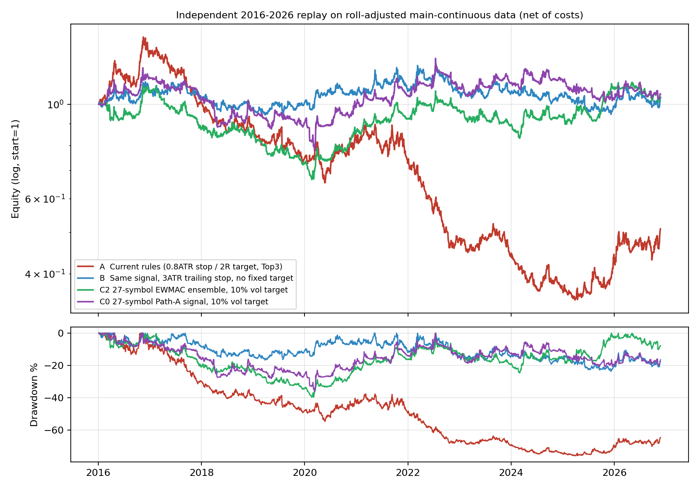

# cta-path-a 升级迭代清单（轨 R：可信度 → 回撤 → 收益）

> **依据**：本地 `D:\AI\cta-path-a`（2026-11-23 版本）源码；正式结果 `historical_backtest_latest.json`（`cta-backtest-v13-tradability`，2025-12-30→2026-11-20）；`paper_book_latest.json`（asof 2026-11-23）；`.cache/history/{CODE}0.json`（2014 年起的主连日线）。审计期间只读，没有改动仓库里的任何文件。
>
> **用法**：严格按 R0→R16 的顺序，**一次只开一刀**，每刀结束按 `docs/UPGRADE_ITERATIONS.md` 的规矩写 3–6 行反馈。标 🔒 的刀会改变正式 KPI：动手前要磊签字，完成后更新 `configs/formal_rule_lock.json`。
>
> 文中行号以本版本为准，Cursor 改动后行号会漂移，请按函数名定位。

---

## 0. 总判断

1. **现在的正式成绩不可信**。引擎里至少有 5 类错误，方向不一（有的低估收益，有的低估亏损），所以 +5.78% / 6.74% 这组数字既不能证明策略有效，也不能证明无效。**先修引擎，再谈参数。**
2. **现行规则在长样本上不赚钱**。十年近似重放（附录 A）：年化 −6.0%，最大回撤 −75.9%，11 年里 4 年正收益。只改出场（3×ATR 吊灯止损、去掉固定止盈），回撤降到 −23.7%，但年化只有 +0.3%。→ **降回撤有明确路径；提高收益必须找新的独立收益来源，调参做不到。**
3. **顺序**：阶段 A 让数字可信（R0–R7）→ 阶段 B 结构性降回撤（R8–R12，长样本闸门）→ 阶段 C 新收益来源（R13–R14）→ 阶段 D 治理（R15–R16）。

---

## 1. 刀序总表

| 刀 | 名称 | 阶段 | 改正式层 | 依赖 | 主要文件 |
|----|------|------|----------|------|----------|
| R0 | 冻结基线 | A | 否 | — | `archive/` |
| R1 | 分钟线合约错配 → 假止损 | A | 🔒 | R0 | `minute_data.py` `wyckoff_pullback.py` `historical_backtest.py` `paper_book.py` |
| R2 | 夜盘交易日归属 | A | 🔒 | R1 | `minute_data.py` `historical_backtest.py` |
| R3 | 跳空穿越止损按开盘价成交 | A | 🔒 | R0 | `wyckoff_pullback.py` |
| R4 | 组合帽计入已有持仓 | A | 🔒 | R0 | `historical_backtest.py` `position_rules.py` `daily_update.py` `paper_book.py` |
| R5 | 模拟账本与回测引擎对齐 | A | 🔒 | R1–R4 | `paper_book.py` |
| R6 | 换月复权（信号/ATR） | A | 🔒 | R0 | 新 `research/data_quality/adjusted.py`、`historical_backtest.py` |
| R7 | 正式重跑 + v14 新基线 + n_trials 更正 | A | 🔒 签字点 | R1–R6 | `historical_backtest.py` `README.md` |
| R8 | 长样本研究入口 | B | 否 | R7 | `historical_backtest.py`（新 CLI） |
| R9 | 出场方案对照（预注册 5 组） | B | 否（过闸后另批） | R8 | `historical_backtest.py` `execution_rules.json`（新字段） |
| R10 | 让风险预算真正生效 | B | 否（过闸后另批） | R9 过闸 | `position_rules.py` |
| R11 | 组合波动目标 + 回撤刹车 | B | 否 | R9 | `historical_backtest.py` |
| R12 | 品种池与持仓数（可选） | B | 否 | R10 | `universe.json`（研究副本） |
| R13 | 席位因子长样本验证 | C | 否 | R8 | `lab/scripts/backfill_member_cache.py` 等 |
| R14 | 期限结构 carry 独立袖套（细化见 `docs/CARRY_SLEEVE_R14.md`，K0–K7） | C | 否 | K0–K2 可与阶段 A 并行；K4 起依赖 R6、R8 | 新 `research/carry/` |
| R15 | 试验登记强制化 + DSR 真实 n_trials | D | 否 | 随时 | `research/governance/experiment_registry.py` |
| R16 | 晋级门槛写进代码 | D | 否 | R15 | `research/governance/strategy_gate.py` |

---

## 2. 阶段 A：回测可信度（🔒）

### R0 冻结基线

**目标**：之后每一刀都和同一个起点比，而且比较用同一份输入快照离线重放，不受新抓数据影响。

> **2026-11-23 核实**：正式结果 `historical_backtest_latest.json` 记录的输入快照 `archive/snapshots/bt_input_20261120_53d47ac78c7b.json` 本地不存在（本地只有 3 份 `bt_input_20261113_*`）；`lab/shadow/replay.py` 把快照路径写死成 `bt_input_20261113_d246813d911a.json`。所以 R0 要先把快照找回来（或重新生成），并把重放脚本参数化。可直接粘贴的 Cursor 指令见 `docs/CURSOR_PROMPTS_R0_R1.md`。

**做法**

1. 提交 `docs/` 下的新文档（本地提交，不推送）。
2. 找回正式快照：先 `git fetch`，再用 `git restore --source origin/main -- archive/snapshots/bt_input_20261120_53d47ac78c7b.json` 从远端恢复。远端也没有，就给 `historical_backtest.py` 的 `main()` 加一个 `--out PATH` 参数（写到非根目录时不触发规则锁、不写 `archive/backtest_*.json`，也绝不允许写根目录的 `historical_backtest_latest.json`），跑一次生成新快照，用它当基线。
3. 参数化 `lab/shadow/replay.py`：`--snap`（默认取结果 JSON 的 `input_snapshot.path`）、`--bt`（提供 `contract_pack` 的结果 JSON，默认根目录 latest）、`--out`。
4. 新增 `scripts/audit_exit_vs_daily.py`：逐笔核对 `closed_pnls` 的止损/止盈是否在同口径日线上真的触及。快照在时用快照 bars；快照缺失时，连续口径回退 `.cache/history/{CODE}0.json`，合约口径回退 `.cache/contracts/{SYM}.json`。
5. 生成基线产物到 `archive/R0/`（`archive/` 不计入规则锁的 dirty 检查），提交工具改动，打 tag `baseline-R0`。

**验收**：
- 重放能复现基线结果：`closed_trades` 一致，`ret_pct`、`max_dd_pct` 差 ≤ 0.05 个百分点；复现不了就把差异写进反馈，以重放结果作为 R1 的比较基线，不在 R0 修。
- 在正式结果上审计，连续合约口径正好报出 3 笔不符：FU 2026-09-28、PP 2026-10-20、P 2026-11-13。
- tag `baseline-R0` 存在；根目录的 `historical_backtest_latest.json`、`paper_book_latest.json` 没被改动。

---

### R1 修复分钟线合约错配导致的假止损（最高优先）

**证据**

- `minute_data.load_minute_bars_series` 会把 `.cache/akshare/minute/{CODE}*_15_sina.json` 下所有月份合约的分钟线按时间戳合并。本地没有 `{CODE}0` 分钟文件时，连续合约仓位就会拿某个月份合约的分钟线来判止损。
- `wyckoff_pullback.minute_bars_aligned_with_entry` 的容差是 5%，挡不住正常的跨月基差。
- **实例**：FU 多 2 手，2026-09-23 入场 4120（`continuous_proxy`），止损 3951.8，止盈 4456.5。
  - 2026-09-28 主连日线：低 4293 / 高 4463 / 收 4418 → **止损没碰到，止盈碰到了**。
  - 本地 FU 只有 `FU2701_15_sina.json`。FU2701 当天 09:15 最低 3916 < 3951.8 → 被记成止损 −1R。
  - 对齐检查：FU2701 分钟中位价约 3995，与入场价 4120 偏差 3.0% < 5%，检查通过。
- 按主连日线逐笔复核连续合约口径的止损/止盈，**一共 3 笔假止损**：

| 平仓日 | 品种 | 方向 | 手数 | 止损价 | 主连当日低/高 | 正确结果 |
|--------|------|------|------|--------|---------------|----------|
| 2026-09-28 | FU | 多 | 2 | 3951.8 | 4293 / 4463 | 止盈 +2R（4456.5） |
| 2026-10-20 | PP | 多 | 1 | 9131.9 | 9250 / 9452 | 未触发，继续持有 |
| 2026-11-13 | P | 空 | 1 | 9045.9 | 8944 / 9022 | 未触发，继续持有 |

- **影响**：光 FU 一笔就从 −1R 变成 +2R，差约 3R × 3,364 元 ≈ **1.0 万元**，接近全年净利 1.16 万元。正式结果里分钟线触发的平仓一共 7 次（`minute_stop_exits=7`），其中 3 次是假的。

**改法**（2026-11-23 核实后修订）

> 原方案“连续合约仓位只读 `{CODE}0` 分钟线”作废：本地 `.cache/akshare/minute/` 下 38 个 15 分钟文件全是月份合约（如 `FU2701_15_sina.json`），没有任何 `{CODE}0_15_*.json`，照原方案做等于关掉分钟线判定。原方案第 5 步“`max_rel_diff` 从 0.05 收紧到 0.01”也作废：这个检查拿分钟中位价和**入场价**比，持仓期间价格正常走出 1% 就会误拒。改为用**同口径日线**校验分钟线。

1. `minute_data.py` 新增 `day_session_bars(bars)`：去掉时间 ≥ 20:00 的 K 线（属于下一个交易日；完整的交易日归属在 R2 处理）。只有日期、没有时间的 bar 原样保留。不改 `load_minute_bars_on_date` 的默认行为（图表板也在用）。
2. `wyckoff_pullback.py` 新增 `minute_bars_match_daily(minute_bars, day_bar, *, tick, tol_ticks=2)`，两条同时满足才算同一个合约：
   - (a) 分钟线的最高、最低价落在日线 [low, high] ± 2 跳内；
   - (b) 15:00 及以前最后一根分钟线的收盘价与日线收盘价相差 ≤ 2 跳。
3. `historical_backtest.simulate` 持仓管理段（`load_minute_bars_on_date` 调用处，约 1339–1360 行）：入场日 cutoff 过滤之后，先 `day_session_bars`，再 `minute_bars_match_daily(m_bars, mbar, tick=...)`，不通过就置 `[]` 回退日线；新增计数 `minute_rejected_mismatch` 写进输出。保留原有的 `minute_bars_aligned_with_entry` 检查。
4. `paper_book._intraday_stop_exit`：同样两步；日线取 `.cache/history/{CODE}0.json` 里 date == asof 的那根，取不到就不用分钟线（日线兜底平仓在 R5 做）。
5. 审计脚本 `scripts/audit_exit_vs_daily.py` 已在 R0 建好，本刀用它验收。

**实测依据**：本地 8 个品种（FU2701、MA2701、P2701、SA2701、M2701、I2701、RB2701、EB2612）共 361 个交易日。该月份合约就是当日主连时，(a)+(b) 100% 通过；不是主连时 100% 被拒。其中 I2701 有 1 天包络碰巧落在主连区间内，只靠 (b) 才拒掉，所以两条都要。

**新增测试** `tests/test_minute_daily_match.py`：FU2701 分钟线对 FU0 日线被拒；主连月份合约被接受；包络在区间内但收盘对不上被拒；`day_session_bars` 去掉 21:15 那根；记录旧路径会误判止损。具体用例见 `docs/CURSOR_PROMPTS_R0_R1.md`。

**验收**：pytest 全绿；用同一份快照重放后，`audit_exit_vs_daily.py` 输出 0 笔不符；FU 2026-09-23 入场那笔不再在 09-28 记为止损；`minute_rejected_mismatch` > 0。

---

### R2 夜盘交易日归属

**证据**

- `minute_data.load_minute_bars_on_date` 最后一行是 `datetime[:10] == day_iso`（约 264 行），按**自然日**切分。
- 缓存里夜盘 K 线的 `date` 写的是自然日：FU2701 的 `2026-11-23 21:15` 标成 `2026-11-23`，但它属于 **11-24 交易日**。
- 后果：(a) T 日判止损时用到了 T 日收盘以后的夜盘价，属于未来数据；(b) T 日真正的夜盘（前一晚 21:00 起）反而被漏掉。
- `simulate` 入场日的 `cutoff = f"{d} 09:00:00"`（约 1345 行）也是按自然时间截的。

**改法**

```python
import bisect
from datetime import date, timedelta

def trading_day_of(dt: str, sessions: list[str], session_set: set[str]) -> str | None:
    """sessions：升序 'YYYY-MM-DD' 交易日。≥20:00 的夜盘和 <03:00 的凌晨盘归属下一交易日。"""
    day, hm = dt[:10], dt[11:16]
    if hm >= "20:00":
        k = bisect.bisect_right(sessions, day)            # 严格晚于 day 的第一个交易日
    elif hm < "03:00":
        prev = (date.fromisoformat(day) - timedelta(days=1)).isoformat()
        k = bisect.bisect_right(sessions, prev)
    else:
        return day if day in session_set else None
    return sessions[k] if k < len(sessions) else None
```

1. 交易日序列复用现有日历（`research/data_quality/calendar.py`，或 `member_rank.session_calendar_ymds`），不要另造。
2. `load_minute_bars_on_date` 改成按 `trading_day_of(...) == day` 过滤。
3. 入场日 cutoff 的处理，**先核实一件事**：任选一个有夜盘的品种（例如 FU、P），对比 3 个交易日“新浪日线 open”与“前一晚 21:00 第一根 15 分钟线的 open”。
   - 如果相等（日线 open 就是夜盘开盘价）：入场日从该交易日第一根分钟线开始检查，删掉 09:00 cutoff。
   - 如果不等（日线 open 是日盘开盘价）：入场日只用同一交易日 ≥09:00 的分钟线。
   - 把核实结果写进 `fill_note`。

**新增测试** `tests/test_trading_day_of.py`：周五 21:15 → 下周一；周六 01:30 → 下周一；周三 14:45 → 周三；节前最后一晚（例如国庆前）→ 节后第一个交易日。

**验收**：测试通过；随便取一个交易日加载，分钟线的时间范围是 [前一晚 21:00，当日 15:00]。

---

### R3 跳空穿越止损按开盘价成交

**证据**：`wyckoff_pullback.apply_stop_target`（约 442–463 行）在 `low <= stop` 时直接按止损价成交。开盘就跳过止损时，回测里的亏损比实际小。

**影响范围**：`historical_backtest`、`proxy_cta`、`paper_book`（经由 intraday 函数）、`scripts/shadow_pullback_abc.py`；测试 `test_intraday_exits.py`、`test_basis_lock.py`。

**改法**

```python
def apply_stop_target(direction, entry, stop, target, bar):
    """开盘穿越止损按开盘价成交；止盈仍按 target 价（保守，不计入有利跳空）。
    target 为 None 表示没有固定止盈（R9 需要）。"""
    high, low, close = float(bar["high"]), float(bar["low"]), float(bar["close"])
    o = float(bar.get("open") if bar.get("open") is not None else close)
    if direction == "多":
        if o <= stop:
            return "stop", o
        if low <= stop:
            return "stop", stop
        if target is not None and high >= target:
            return "target", target
        return None, close
    if o >= stop:
        return "stop", o
    if high >= stop:
        return "stop", stop
    if target is not None and low <= target:
        return "target", target
    return None, close
```

`apply_stop_target_intraday` 本来就是逐根调用 `apply_stop_target`，不用另改。

**新增测试**：多单 stop=98，bar open=96 / low=95 → `("stop", 96)`；空单 stop=102，open=104 → `("stop", 104)`；`target=None` 时不触发止盈。

**验收**：原有 `test_intraday_exits`、`test_basis_lock` 不改断言也能通过（它们不涉及跳空）；新测试通过。

---

### R4 组合帽计入已有持仓

**证据**

- `historical_backtest.simulate` 约 1606 行，`apply_portfolio_caps(cands, ...)` 只传入**当天的候选**。名义 50% 和组合 ATR 风险 8% 两个上限只约束新开仓；板块上限在 1617–1628 行另外补了，名义和风险没补。
- 同一个文件约 1760–1774 行（roll_carry 分支）已经正确算了已有持仓的 `used_gross`、`used_risk`，主分支没复用。
- 结果：63 个建仓日里有 **19 天**建仓后名义敞口 > 50%，最高 **91.4%**（2026-06-17，FU+I+JD）。
- `daily_update._apply_caps` 同样不知道模拟账本里已有的持仓；`paper_book.refresh_paper_book` 的开仓循环只有 `if code in kept: continue`，不检查持仓数、板块和名义。

**改法**

1. 抽一个 helper（直接从 1760–1774 行搬过来）：

```python
def _book_usage(pos, idx, series, d):
    used_gross = used_risk = 0.0
    buckets: dict[str, int] = {}
    for code_, p_ in pos.items():
        b_ = str(p_.get("bucket") or "_")
        buckets[b_] = buckets.get(b_, 0) + 1
        i_ = idx[code_].get(d)
        if i_ is None:
            continue
        h_ = series[code_]["hist"]
        m_ = float(series[code_]["meta"]["mult"])
        n_ = abs(int(p_["lots"]))
        used_gross += n_ * float(h_[i_]["close"]) * m_
        a_ = atr14(h_, i_) or float(p_.get("atr") or 0)
        used_risk += n_ * float(a_) * m_
    return used_gross, used_risk, buckets
```

2. 约 1606 行改成：

```python
used_g, used_r, held_buckets = _book_usage(pos, idx, series, d)
eq_ = sizing_eq if sizing_eq > 0 else 1.0
selected, _meta = apply_portfolio_caps(
    cands,
    equity=sizing_eq,
    max_positions=slots_left,
    max_gross_exposure_pct=max(0.0, max_gross_pct - used_g / eq_ * 100.0),
    max_portfolio_risk_pct=max(0.0, max_port_risk - used_r / eq_ * 100.0),
    max_per_bucket=max_per_bucket,
    existing_buckets=held_buckets,
    min_r20_pct=0.0 if mode == "ctf" else min_r20,
    min_r60_pct=0.0 if mode == "ctf" else min_r60,
    min_lots=min_lots,
)
```

3. `position_rules.apply_portfolio_caps` 增加参数 `existing_buckets: dict | None = None`：步骤 2–3 和 refill 段里的 `bucket_counts` 用 `dict(existing_buckets or {})` 初始化。
4. roll_carry 分支改成调用同一个 `_book_usage`。
5. `daily_update._apply_caps(signals, *, sizing_equity, held=None)`：`held` 传入 `paper_book_latest.json` 的 positions，按同样的方法扣减额度。`paper_book` 开仓前再校验一次（防止同一天跑两次）。

**新增测试** `tests/test_caps_include_book.py`：已有 2 仓、名义合计 45%，新候选名义 20% → 必须缩手或丢弃；已有能化 1 仓时，新的能化候选被板块帽拦下。

**验收**：测试通过；重跑后 `equity_curve` 里所有建仓日 `gross_pct ≤ 50`（入场后价格漂移造成的超限允许）。

---

### R5 模拟账本与回测引擎对齐

**证据**（`paper_book_latest.json`，asof 2026-11-23）

| 持仓 | 入场 | 止损 | 止盈 | 现价 | 状态 |
|------|------|------|------|------|------|
| P 空 1 手 | 8961 | 9119.3 | **8644.3** | 8251 | 早已越过止盈，仍持有（浮盈 7,100） |
| I 空 1 手 | 640.5 | **650.0** | 621.5 | 654 | 已越过止损，仍持有 |

- 原因：`refresh_paper_book` 只靠 15 分钟线判止损/止盈（`_intraday_stop_exit`）。分钟线缺失或对不齐时，直接跳到信号平仓，**没有日线 OHLC 兜底**。
- 入场价口径不同：`_open_from_signal` 用信号日收盘价 `entry=close`，回测用 T+1 开盘价。
- 两边权益：模拟账本 190,332 元，回测 211,555 元，相差 2.1 万元。

**改法**

1. `_intraday_stop_exit` 返回 `None` 时，读取 asof 当天的日线（用 `market_data` 现有的本地缓存读取，不联网），走 R3 改过的 `apply_stop_target` 兜底。
2. 入场分两步：T 日写一条 `pending`（方向、手数、止损距离、止盈距离）；T+1 运行时用当日 open 成交，并像 `next_open_fill` 那样平移止损和止盈。
3. 开仓前按 R4 校验持仓数、板块和名义。
4. 已经错过止盈/止损的现有持仓：按日线回放补记平仓，写入 ledger 并标注 `backfill_R5`，不要直接删除。

**新增测试** `tests/test_paper_vs_backtest_reconcile.py`：用同一份 `input_snapshot` 跑回测的最后 40 个交易日，同时逐日回放模拟账本 → 两边的交易列表（品种、方向、入场日、出场日、原因）完全一致，权益差 < 0.5%。

**验收**：测试通过；Desk 上同一天的模拟账本权益与回测曲线相差 < 0.5%。

---

### R6 换月复权（信号和 ATR 用复权序列，盈亏用真实价格）

**证据**

- 信号 `ret_n` 和 `atr14`（约 1483、1495 行）直接用新浪 `{CODE}0` 未复权主连。
- 2015 年以来隔夜跳空 > 3% 的次数：FU 179、JD 56、BU 56、JM 48、I 46、AG 46、MA 44……其中很大一部分是换月价差。
- 66 笔正式交易里 40 笔（61%）按连续合约价格管理（`proxy_entry_share=0.606`，结论本身也写着「proxy偏高」）。
- 十年近似重放里，同一套 EWMAC 规则：未复权年化 −1.4%，复权后 +0.3%。换月噪声本身就有每年 1–2 个点的影响。

**改法**

1. 新建 `research/data_quality/adjusted.py`：
   - `roll_dates(code)`：优先用 A2 已完成的 `active_front_contract_on_date` 取每日主力合约，主力切换日就是换月日。没有映射的历史段，用“持仓量单日变化 > 40% 且隔夜跳空 > 0.5%”兜底，并在输出里标注来源（`mapping` / `oi_heuristic`）。
   - `back_adjust_ratio(hist, rolls)`：换月日因子 = 同一天新合约收盘 / 旧合约收盘，向过去累乘；**最新一段因子 = 1**，保证 T 日算出的止损价单位正确。
2. `simulate` 里：信号（r20/r60）、ATR、`vol_bypass` 用复权序列；成交、止损/止盈判定、盯市继续用原始价格（contract 或 continuous）。
3. KPI 里新增 `adjusted_roll_days`，按品种计数。

**新增测试**：人造两段合约（旧合约 100、新合约同日 110），复权后 r20 跨越换月日不跳变；最新一段的价格与原序列完全一致。

**验收**：换月日复权序列的隔夜跳空等于新合约自身的隔夜跳空；不跨换月的窗口里 r20/r60 与原序列完全相同。

---

### R7 正式重跑 + v14 新基线（🔒 签字点）

```powershell
python -m pytest tests/ -q
python historical_backtest.py --fill next_open
python lab/scripts/run_formal_scorecard.py
python lab/scripts/run_pbo_path_a.py --mode seats
python scripts/audit_exit_vs_daily.py historical_backtest_latest.json
```

**要做的事**

1. 产出 `archive/R7_fix_impact.json`：逐刀累计对比表（R0、+R1、+R1R2、……、+R1–R6），字段包括 ret / gross_ret / max_dd / 笔数 / minute_stop_exits / proxy_entry_share / same_day_exit_share。
2. **更正 n_trials**：约 1938–1945 行写的是 `n_trials_assumed = 1 + len(archived_params) = 5`。但光 2026-11-11 那一轮 `archive/shadow_strategy_opt_t1_20261111.json` 就试了 8 组，PBO 矩阵是 11 组。过渡期先用 `max(1 + len(archived), PBO n_trials, 各轮 shadow rows 之和)`，R15 之后改成从登记表读取。
3. **README 的 KPI 段改为脚本生成**：现在 README 写的是「2025-12-23→2026-11-13，净 +5.0%、回撤 3.3%、成交 43」，最新 json 是 +5.78% / 6.74% / 66 笔，两者对不上。新增 `scripts/render_readme_kpi.py`，从 latest json 生成这一段。
4. `schema_version` 改为 `cta-backtest-v14-execfix`。

**验收**：`audit_exit_vs_daily.py` 输出 0 行；对比表已落库；磊签字后更新 `configs/formal_rule_lock.json`。

> **注意**：修完以后数字可能变好，也可能变差（R1 会让收益变好，R3、R4 会让收益变差）。这一阶段只为了让数字可信。**不要因为结果变差就回退修复。**

---

## 3. 阶段 B：结构性降回撤（先 Shadow，过闸才晋级）

### R8 长样本研究入口（不碰正式文件）

**证据**：`LOOKBACK_DAYS = 260`（第 47 行），正式回测只有 215 个交易日、66 笔交易，任何参数比较都淹没在噪声里（DSR 0.30）。本地 `.cache/history/{CODE}0.json` 已经有 2014 年以来的日线。

**改法**

1. `historical_backtest.py` 增加命令行参数 `--start`、`--end`、`--history-source {sina,cache}`、`--out`。
2. `--history-source cache` 时读 `.cache/history/{CODE}0.json`，经过 R6 复权。
3. `--out` 默认写到 `lab/research/long/`；只要没写 `--out`，或者传了 `--start`，就加断言**禁止写** `historical_backtest_latest.json`。
4. 长样本先用 `mode=base`（席位历史不够长，见 R13）。

```powershell
python historical_backtest.py --fill next_open --mode base --history-source cache --start 2016-01-01 --out lab/research/long/R8_base_V0.json
```

**验收**：能跑通；同一输入跑两次结果 sha 一致；`git diff historical_backtest_latest.json` 为空。

> 参考：我在云端用同一份历史做了简化重放（无席位、按比例仓位、近似复权），现行规则年化 −6.0%、最大回撤 −75.9%、11 年里 4 年正收益。R8 的意义是用你自己的引擎**确认或推翻**这个结论。

---

### R9 出场方案对照（预注册 5 组，跑完不再追加）

**理由**：0.8×ATR 的止损比一天的平均真实波幅还小，所以平均持仓只有 0.91 天，56% 以止损出场，17 笔（26%）当天进当天出。20/60 日的趋势信号，实际被当成了日内方向来赌。

**变体**（`execution_rules.json` 新增字段 `exit_scheme`；正式默认值仍是 V0）

| ID | 初始止损 | 固定止盈 | 移动止损 | `exit_scheme` |
|----|----------|----------|----------|----------------|
| V0 | 0.8×ATR | 2R | 无 | `{"type":"fixed_rr"}`（现行） |
| V1 | 1.5×ATR | 3R | 无 | `{"type":"fixed_rr"}` + stop 1.5 / rr 3 |
| V2 | 2.0×ATR | 无 | 无（只按信号失效出场） | `{"type":"signal_only"}` |
| V3 | 3.0×ATR | 无 | 3.0×ATR 吊灯止损 | `{"type":"trail_atr","trail_atr_mult":3.0}` |
| V4 | 2.0×ATR | 无 | 浮盈 ≥1R 后切 3.0×ATR 吊灯 | `{"type":"breakeven_then_trail","trail_atr_mult":3.0}` |

**代码**（`simulate` 持仓管理段，在“没有触发任何平仓”之后执行）

```python
scheme = exit_scheme or {"type": "fixed_rr"}
if reason is None and scheme.get("type") in ("trail_atr", "breakeven_then_trail"):
    a_t = atr14(hist, i1)                      # R6 之后用复权 ATR
    if a_t:
        k = float(scheme.get("trail_atr_mult", 3.0))
        init_risk = abs(p["entry"] - p["init_stop"])
        armed = scheme["type"] == "trail_atr" or sign * (mbar["close"] - p["entry"]) >= init_risk
        if armed:
            new_stop = mbar["close"] - sign * k * a_t
            p["stop"] = max(p["stop"], new_stop) if sign > 0 else min(p["stop"], new_stop)
```

**必须同时改的两处**

- 入场时记录 `row["init_stop"] = row["stop"]`；`closed_pnls` 里的 R 改用 `init_stop` 计算。现在的代码是 `risk = abs(p["entry"] - p["stop"])`，止损一移动，R 就算错了。
- 没有固定止盈的变体把 `target` 设为 `None`，依赖 R3 里 `apply_stop_target` 对 `target is None` 的处理。

**预注册闸门**（全部满足才进入 R10 和晋级评估）

1. R8 长样本、Stress 成本：MaxDD ≤ 0.7 × V0。
2. 长样本 Calmar ≥ V0，正收益年份数 ≥ V0。
3. 正式窗口（seats、Base 成本）：净收益 > 0，且 MaxDD ≤ 1.2 × V0。
4. 5 组全部登记进 `experiment_registry`，计入 n_trials。

**参考**（十年近似重放，扣成本，2016-01→2026-11）

| 变体 | 年化 | 最大回撤 | Sharpe | 正收益年份 | 平均持有天数 |
|------|------|----------|--------|------------|--------------|
| V0 0.8ATR/2R | −6.0% | −75.9% | −0.29 | 4/11 | 2.4 |
| V1 1.5ATR/3R | −2.2% | −39.1% | −0.09 | 4/11 | 8.8 |
| V3 3ATR 吊灯 | +0.3% | −23.7% | 0.08 | 5/11 | 14.0 |

> 近一年窗口（无席位近似）里 V3 的收益反而低于 V0（+8.0% 对 +22.1%）。所以闸门 3 只要求“正收益、回撤不明显变差”，不要求超过 V0。要接受用最近一年的漂亮收益，换十年尺度上回撤从 −76% 降到 −24%。

---

### R10 让风险预算真正生效（只在 R9 有变体过闸后开）

**证据**

- 设计上单笔风险 2%（4,000 元），实际 66 笔的**中位风险只有 974 元，即 0.49%**；48 笔只有 1 手。原因是 `position_rules.apply_portfolio_caps` 第 4 步的名义 50% 上限先把手数压到了底。
- 20 万权益下 1 手的名义与 ATR 风险（取最新数据）：

| 品种 | 1 手名义 | 占权益 | 1 手 ATR 风险 | 占权益 |
|------|----------|--------|---------------|--------|
| AU 沪金（观察） | 768,560 | 384% | 21,929 | 11.0% |
| CU 沪铜（观察） | 462,000 | 231% | 12,221 | 6.1% |
| RU 橡胶 | 186,250 | 93% | 4,371 | 2.2% |
| AG 沪银 | 150,570 | 75% | 8,650 | 4.3% |
| NI 沪镍（观察） | 117,300 | 59% | 2,503 | 1.3% |
| AL 沪铝（观察） | 107,675 | 54% | 2,220 | 1.1% |
| P 棕榈油 | 83,360 | 42% | 2,004 | 1.0% |
| FU 燃油 | 37,780 | 19% | 2,734 | 1.4% |
| RB 螺纹钢 | 30,040 | 15% | 297 | 0.15% |
| FG 玻璃 | 17,700 | 9% | 474 | 0.24% |

  RU、AG 在主池里，但 1 手名义就超过 50% 帽，永远开不出来，却照样参与排名。

**改法**

1. **可交易预筛**：1 手 ATR 风险 > 1.5 × 单笔风险预算，或者 1 手名义 > 名义帽 → 当天不进候选（而不是先缩到 0 再 refill）。在 `simulate` 生成 `cands` 时判断。
2. 单笔风险预算按 R9 胜出变体的止损距离重新设定（止损变宽以后，同样的风险对应的手数会自然变少）。预注册 0.75% 和 1.0% 两档。
3. 名义帽从 50% 改成“安全帽”（例如 150%，对应保证金占用约 15%–25%）；组合 ATR 风险 8% 保留，作为主约束。

**验收**：实际单笔风险的中位数落在目标的 70%–130%；长样本闸门同 R9。

> **警告**：只有 R9 在长样本上证明期望为正之后才能放大风险。对没有正期望的策略加风险，只会放大亏损。

---

### R11 组合波动目标 + 回撤刹车

**改法**（`simulate` 每日 sizing 处，只用 t−1 及以前的数据）

- 组合缩放：`k_t = clip(10% / 过去 60 日组合实现年化波动, 0.3, 1.5)`，乘到 `day_risk` 上。
- 回撤刹车：净值回撤 > 8% → 新开仓风险 × 0.5；> 12% → × 0.25；创新高，或进入刹车满 20 个交易日后恢复。
- 预注册 3 组：只开波动目标 / 只开回撤刹车 / 两个都开。

**闸门**：长样本 MaxDD 在 R9 胜出变体的基础上再降 ≥ 20%，且 Calmar 不下降。回撤刹车在趋势策略上经常错过反弹，**不要预设它有效**，以长样本结果为准。

---

### R12 品种池与持仓数（可选实验）

- 主池剔除 1 手名义 > 50% 的品种（RU、AG），或者移到观察袖套。
- 对比 Top3 和 Top5（每个板块 ≤ 2）。
- 我的近似重放里 Top8 的回撤反而更大（−32.7% 对 −23.7%），所以**不要预设越分散越好**，按 R9 的闸门判断。

---

## 4. 阶段 C：新增独立收益来源（Research → Shadow）

### R13 席位因子长样本验证

**证据**：大商所品种（V、EG、M、EB、PP、L、JD、P、I、JM）只有 110–113 个席位交易日；不足 `MIN_SEAT_DAYS=60` 的那段时间全部按“缺席位放行”处理（`seat_follows`：缺席位 461 次，跟随机构 744 次）。目前**无法判断**席位过滤到底贡献了多少。

**做法**

1. 用现有的 `lab/scripts/backfill_member_cache.py`、`lab/shadow/fix3/dce_seat_hist_backfill.py`，把三家交易所的会员排名回补到 2019 年或更早。
2. 在 R8 入口上跑 `--mode base` 和 `--mode seats`：同一个长窗口，同一个出场方案。
3. 分年统计两者差异。

**闸门**：seats 相对 base 的 Sharpe 提升 ≥ 0.2，并且在 ≥ 2/3 的年份为正。达不到就把 `entry_filter` 改回 `base`，简化系统。

---

### R14 期限结构（carry）独立袖套

> **本节已细化为独立文档 `docs/CARRY_SLEEVE_R14.md`，以该文档为准。** 这里只保留摘要。

**现状**：carry 只用来做“禁开”旁路（|gap| ≥ 1%）。用现有因子面板做的原型（2019-01→2026-10，扣成本）全部为负：横截面 carry 年化约 −6%～−8%，基差动量约 −7.5%，IC 接近 0；与趋势相关约 0.2。原因是面板构造有 4 个缺陷（D1 用到期最近的两个合约而非主力/次主力；D2 价差未按到期间隔年化；D3 基差动量跨合约切换计算；D4 收益用主连而非持有合约），所以**现有数据判断不了 carry**。

**刀序**（详见细化文档）

- **K0** 分月合约历史日线库（2016 起，含郑商所老合约代码核实）
- **K1** 可交易期限曲线：主力/次主力，剔除距交割月 < 20 个交易日的合约，按到期天数年化
- **K2** 持有合约收益指数（T+1 开盘换月，计换月成本）
- **K3** 预登记 5 个信号（横截面 carry、时序 carry、固定合约对基差动量、二者组合、去季节 carry）× {原始、板块中性} = 10 个试验
- **K4** 独立袖套回测引擎（逆波动率加权、目标波动 8%、Base/Stress 成本）
- **K5** 整手与 20 万元可行性
- **K6** 验证与闸门（Stress Sharpe ≥ 0.4、IC t ≥ 2、与趋势相关 < 0.3、DSR ≥ 0.9、PBO ≤ 0.3 等）；全部不过闸则关闭此轨，不追加信号
- **K7** Shadow 挂载与组合测试（不写 `paper_book`）

**闸门**：以 `docs/CARRY_SLEEVE_R14.md` 的 K6 为准。

---

## 5. 阶段 D：治理

### R15 试验登记强制化 + DSR 真实 n_trials

- `research/governance/experiment_registry.py` 已经存在。让 `param_sweep.py`、`scripts/strategy_indicator_ablation.py`、`scripts/strategy_blend_grid.py`，以及 `historical_backtest.py` 的 `--rr-grid / --roll-grid / --hedge-grid / --compare`，每跑一组就自动登记一条。
- DSR 的 `n_trials` 改为从登记表读取，替换 R7 的过渡算法。
- CI 增加一个测试：登记数小于 `archive/shadow_*.json` 的 rows 总数时失败。

### R16 晋级门槛写进代码

在 `research/governance/strategy_gate.py` 里写死以下条件；任何一条不满足，只能停留在 Shadow：

| 条件 | 阈值 |
|------|------|
| 长样本长度 | ≥ 8 年 |
| 长样本 Sharpe（Stress 成本） | ≥ 0.5 |
| 长样本 MaxDD | ≤ 20% |
| 正收益年份占比 | ≥ 60% |
| DSR（n_trials 取自登记表） | ≥ 0.9 |
| PBO | ≤ 0.3 |
| 正式窗口净收益 | > 0 |
| 锁定样本外影子跟踪 | ≥ 6 个月 |

---

## 6. 低优先：工程整理（R7 之后再做）

- `historical_backtest.py` 有 2,523 行，`simulate` 一个函数 980 行。拆成 `engine/fills.py`、`engine/exits.py`、`engine/caps.py`、`engine/simulate.py`，用 R7 的 `input_snapshot` 做逐笔回归测试，保证拆分前后零差异。
- `apply_stop_target` 这类核心出场函数放在策略文件 `wyckoff_pullback.py` 里，迁到 `engine/exits.py`，原位置保留 re-export。
- `minute_data.load_minute_bars_series` 的注释写着“先读月份文件，再用 CODE0 覆盖”，代码实际是先读 CODE0、月份文件不覆盖。行为是对的，注释错了，顺手改掉。

---

## 7. 每刀执行模板（直接贴给 Cursor）

```text
开刀 R?：<名称>
范围：只改 <文件列表>；不改 execution_rules.json / universe.json（除非本刀注明）
不得写：historical_backtest_latest.json / paper_book_latest.json（R7 签字前）
步骤：
  1. …
  2. …
测试：新增 <tests/xxx.py>；运行 python -m pytest tests/ -q
产物：<json 路径>
完成后反馈（3–6 行）：做了什么 / 产物 / 验证结果 / 风险与未做 / 建议下一刀或停
```

---

## 附录 A：十年近似重放的方法与局限

- **数据**：`.cache/history/{CODE}0.json`，27 个品种，2015-01→2026-11，回测从 2016-01 开始。
- **换月识别**：持仓量单日变化 > 40% 且隔夜跳空 > 0.5%，按比例向过去复权（超过 3% 的跳空从 929 次降到 702 次，FU 这类品种仍有残留）。
- **规则**：T 日收盘出信号，T+1 开盘成交；开盘穿越止损按开盘价成交；名义上限 50%，单笔风险 2%，Top3，每板块 1 个。
- **成本**：每边 1 跳滑点 + `universe.json` 里的手续费。
- **简化之处**：没有席位、升贴水和波动旁路；仓位按名义比例计算，不取整手；止损止盈按日线判定。
- **用途**：只用来判断方向，不能替代 R8。



**分年度收益（%）**

| 年份 | 2016 | 2017 | 2018 | 2019 | 2020 | 2021 | 2022 | 2023 | 2024 | 2025 | 2026* |
|------|------|------|------|------|------|------|------|------|------|------|-------|
| V0 现行近似 | 33.3 | −24.5 | −11.6 | −16.3 | 8.8 | −9.5 | −34.1 | −9.0 | −17.2 | 17.2 | 19.1 |
| V3 3ATR 吊灯 | 7.8 | −3.9 | −5.7 | 3.2 | 4.1 | 2.4 | −0.6 | −0.8 | −1.5 | −5.2 | 4.8 |

\*2026 年截至 11-23。

**其他测过、不推荐作为主收益来源的方案**（同样的数据和成本）

| 方案 | 年化 | 最大回撤 |
|------|------|----------|
| 27 品种 EWMAC 四档 + 10% 波动目标 | +0.3% | −39.7% |
| 27 品种 Path-A 信号 + 10% 波动目标 | +0.5% | −36.1% |
| 横截面动量（20/60/120 集成） | −4.1% | −45.7% |
| 慢趋势（120/250 日符号） | −1.8% | −35.1% |
| 5 日横截面反转 | −10.8% | −71.3% |

结论：在这个品种池上，价格类信号（趋势、动量、反转）十年都没有稳定的正收益。阶段 C 的非价格数据（席位、期限结构）才是提高收益的主要方向。
